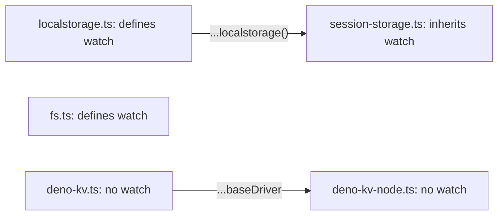

# unstorage-architecture-002: Drivers that report their own changes

**Answer:**

- `src/drivers/fs.ts`
- `src/drivers/localstorage.ts`
- `src/drivers/session-storage.ts`

## Why `watch` matters to the storage layer

A driver's `watch` is optional (`watch?:` in the `Driver` interface, src/types.ts:136). The storage layer uses its presence in two ways:

- `storage.watch()` starts watching every mount, and each mount's helper either subscribes to the driver or returns a no-op:

  ```ts
  // src/storage.ts:623-625
  function watch(driver: Driver, onChange: WatchCallback, base: string) {
    return driver.watch ? driver.watch((event, key) => onChange(event, base + key)) : () => {};
  }
  ```

- After its own writes, the storage emits the change event itself, but *only* for drivers without `watch`, so the event isn't reported twice:

  ```ts
  // src/storage.ts:365-367
  if (!driver.watch) {
    onChange("update", key);
  }
  ```

So a driver with `watch` is trusted to report every change, including changes made outside this process.

## How a strong engineer gets there

1. Search `src/drivers/` for `watch`. Two driver files define a `watch` method on the object they return:
   - `fs.ts` (line 148): `async watch(callback)` loads `chokidar` through `importLib` and turns filesystem events into `update` and `remove` events.
   - `localstorage.ts` (lines 97-108): `watch(callback)` listens for the browser's `storage` event on `opts.window`.
2. The count says 3, so one driver gets `watch` without the word appearing in its file. Look for drivers that import another driver. Only two do: `deno-kv-node.ts` imports `./deno-kv.ts`, and `session-storage.ts` imports `./localstorage.ts`.
3. `session-storage.ts` spreads the localstorage driver's object into its own:

   ```ts
   // src/drivers/session-storage.ts:8-16
   const driver: DriverFactory<SessionStorageOptions, Storage> = (opts = {}) => {
     return {
       ...localstorage({
         windowKey: "sessionStorage",
         ...opts,
       }),
       name: DRIVER_NAME,
     };
   };
   ```

   The spread copies `watch` (along with every other method), and only `name` is overridden.

4. `deno-kv-node.ts` also spreads its base driver (`...baseDriver`), but `deno-kv.ts` has no `watch`, so there's nothing to inherit.



## Why the other candidates are wrong

| Candidate | Why |
|---|---|
| `src/drivers/fs-lite.ts` | It shares `readFile`, `writeFile` and friends with `fs.ts` through `utils/node-fs.ts`, but it has no watcher. That's what makes it "lite", with no `chokidar` dependency. |
| `src/drivers/deno-kv-node.ts` | It inherits from another driver like session-storage does, but its base, `deno-kv.ts`, has no `watch`. |
| `src/drivers/overlay.ts` | It wraps other drivers (`options.layers`), but it calls their item methods directly and never exposes a `watch` of its own. |
| `src/drivers/memory.ts` | The default root driver has no `watch`. Changes to it are reported by the storage layer's own `onChange` calls. |
| `src/storage.ts` | It has a `watch` method and a `watch` helper, but it isn't a driver, and it's outside `src/drivers/`. |

## A detail worth knowing

Having `watch` doesn't guarantee events. The localstorage `watch` returns early when `opts.window` isn't set (line 98). And because the driver has `watch`, the storage layer also stops emitting its own events. So with `localstorage` or `session-storage` and no `window` option, `storage.watch()` callbacks never fire, not even for writes made through the same storage.

## Takeaways

- Capabilities can be inherited through an object spread. A text search for a method name misses drivers that get it from another driver's object, so also check which drivers import other drivers.
- An optional interface method often switches behaviour elsewhere (here, whether `setItem` emits events). When you meet one, search for where its presence is tested.
