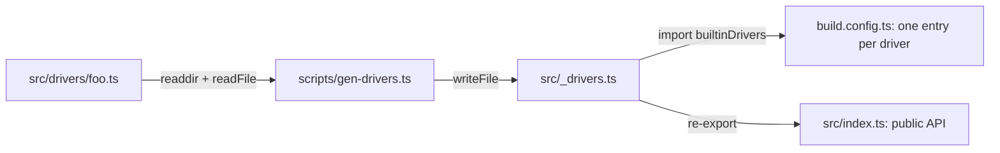

# unstorage-architecture-003: Registering a new built-in driver

**Answer:** `scripts/gen-drivers.ts`

## How a strong engineer gets there

1. Open `src/_drivers.ts`. It's a long, regular file: one `import type` per driver, a union of names, and a `builtinDrivers` object that maps each name (in kebab-case and camelCase) to a subpath like `"unstorage/drivers/cloudflare-kv-binding"`. Files this repetitive are rarely hand-written.
2. Find who writes it. Search the repo for `_drivers`. Apart from a test and the formatter config (`.oxfmtrc.json`), three source files mention it:
   - `src/index.ts` re-exports `builtinDrivers` and its types from it. That's a reader.
   - `build.config.ts` imports `builtinDrivers` to work out the build's entry files. Another reader.
   - `scripts/gen-drivers.ts` builds the path and writes to it. That's the writer.
3. Confirm in the script:

   ```ts
   // scripts/gen-drivers.ts:8-14
   const driversDir = fileURLToPath(new URL("../src/drivers", import.meta.url));

   const driversMetaFile = fileURLToPath(new URL("../src/_drivers.ts", import.meta.url));

   const driverEntries: string[] = (await readdir(driversDir, { withFileTypes: true }))
     .filter((entry) => entry.isFile())
     .map((entry) => entry.name);
   ```

   ```ts
   // scripts/gen-drivers.ts:111
   await writeFile(driversMetaFile, genCode, "utf8");
   ```

So you never register the driver anywhere by hand. The script lists the files in `src/drivers/` (folders such as `utils/` are skipped by `entry.isFile()`), and for each one derives the names, finds the exported `...Options` type, and reads `DRIVER_DEPENDENCIES` if the file declares it.

## How it fits together



`package.json` wires the script into the build, `"build": "pnpm gen-drivers && obuild"`, so the map is rebuilt before every build.

## Why the other candidates are wrong

| Candidate | Why |
|---|---|
| `src/_drivers.ts` | It's the output, and the prompt excludes it. Editing it by hand would be undone the next time the script runs. |
| `build.config.ts` | It *reads* `builtinDrivers` to decide which files to bundle. It never writes `_drivers.ts`. |
| `src/index.ts` | It only re-exports from `_drivers.ts`. |
| `src/drivers/utils/index.ts` | Shared helpers for drivers (`createError`, `importLib`, `joinKeys`, ...). Nothing in it lists drivers. |

## Design notes

Generating the map from the folder keeps three things in step with no manual bookkeeping: the `BuiltinDriverName` type users get autocomplete from, the runtime `builtinDrivers` lookup, and the build's list of entry points. The script also turns names into camelCase aliases (with a special case for `KV`), which is why `builtinDrivers` has both `"cloudflare-kv-binding"` and `"cloudflareKVBinding"`.

## Takeaways

- When a file looks machine-made, look for the generator before editing it. Search for the file's own path in scripts and build config.
- Sort the files that mention a path into readers and writers. Only the writer is the extension point.
