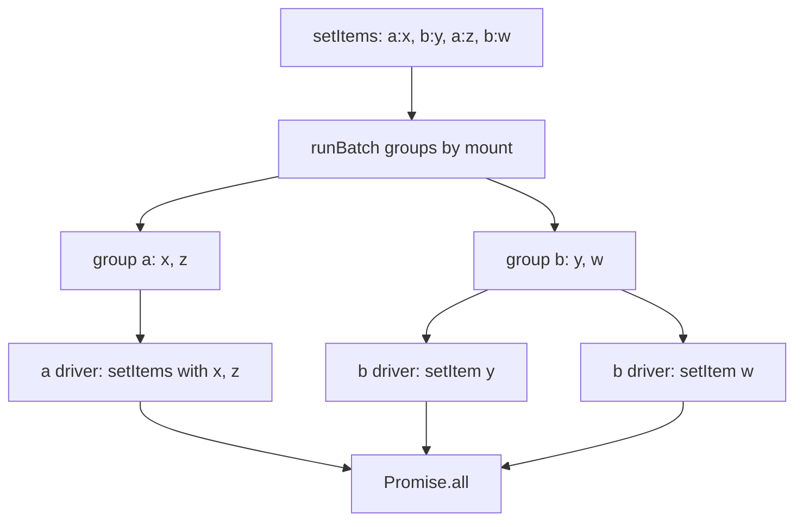

# unstorage-design-001: Batch writes across two backends

**Answer:** c. One setItems call on the `a` driver with the `a:` keys, and one setItem call per `b:` key on the `b` driver, with both drivers' writes in flight at the same time.

## Where to start

`setItems` is a method on the object `createStorage` returns (src/storage.ts:369). Its whole body is one call to `runBatch`, a helper defined inside `createStorage` (lines 224-259), with a callback that writes one group of items.

## Step 1: group by backend

```ts
// src/storage.ts:243-258
    for (const item of items) {
      const isStringItem = typeof item === "string";
      const key = normalizeItemKey(isStringItem ? item : item.key);
      const value = isStringItem ? undefined : item.value;
      const options =
        isStringItem || !item.options ? commonOptions : { ...commonOptions, ...item.options };
      const mount = getMount(key);
      getBatch(mount).items.push({
        key,
        value,
        relativeKey: mount.relativeKey,
        options,
      });
    }

    return Promise.all([...batches.values()].map((batch) => cb(batch))).then((r) => r.flat());
```

`getBatch` (lines 230-241) keeps one group per mount base in a `Map`. Each key goes into the group for the mount that owns it, with the key made relative to that mount, so `a:x` becomes `x` for the `a` driver. Two mounts make two groups.

## Step 2: write each group the best way its driver allows

```ts
// src/storage.ts:370-395
      await runBatch(items, commonOptions, async (batch) => {
        if (batch.driver.setItems) {
          return asyncCall(
            batch.driver.setItems,
            batch.items.map((item) => ({
              key: item.relativeKey,
              value: stringify(item.value),
              options: item.options,
            })),
            commonOptions,
          );
        }
        if (!batch.driver.setItem) {
          return;
        }
        await Promise.all(
          batch.items.map((item) => {
            return asyncCall(
              batch.driver.setItem!,
              item.relativeKey,
              stringify(item.value),
              item.options,
            );
          }),
        );
      });
```

- The `a` group's driver has `setItems`, so it gets one call with all of its keys.
- The `b` group's driver doesn't, so the callback falls back to `setItem`, once per key, all started together inside `Promise.all`.

## Step 3: both groups run at the same time

The last line of `runBatch` maps every group to `cb(batch)` before awaiting anything, then waits on `Promise.all`. The callback for `a` starts its `setItems` call and returns a pending promise, and the callback for `b` starts right after. Neither waits for the other.



## Why the other options are wrong

- **a:** a driver only ever sees the keys in its own group, relative to its own mount. Sending `b:` keys to the `a` driver would write them to the wrong backend.
- **b:** the choice is made per group, inside the callback, from that group's own driver. One driver lacking `setItems` doesn't change how the other is called.
- **d:** nothing orders the groups. `Promise.all` over the mapped callbacks has them all running at once, and the `b` group's `setItem` calls also run together.

## Takeaways

- Grouping a batch by shard, then using each backend's bulk API where it has one, is a standard design for a store that spreads keys over several backends.
- The batch isn't atomic. If one backend fails, `Promise.all` rejects, but writes the other backend already made stay. A design that needs all-or-nothing writes needs more than this, such as a write-ahead log or a two-phase commit.
