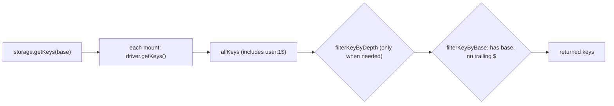

# unstorage-find-001: Hidden metadata keys

**Answer:** `src/utils.ts#filterKeyByBase`

## How a strong engineer gets there

1. The prompt describes what `getKeys` leaves out, so start at `getKeys`. Open `src/storage.ts` and find the `getKeys` method of the object built inside `createStorage`.
2. Read it to the end. It collects keys from every mount into `allKeys`, then returns a filtered copy:

   ```ts
   // src/storage.ts:496-501
   const shouldFilterByDepth = opts.maxDepth !== undefined && !allMountsSupportMaxDepth;
   return allKeys.filter(
     (key) =>
       (!shouldFilterByDepth || filterKeyByDepth(key, opts.maxDepth)) &&
       filterKeyByBase(key, base),
   );
   ```

3. There are two predicates. Go to definition on each (both are imported from `./utils.ts`). Only one of them looks at the last character of the key:

   ```ts
   // src/utils.ts:146-152
   export function filterKeyByBase(key: string, base: string | undefined): boolean {
     if (base) {
       return key.startsWith(base) && key[key.length - 1] !== "$";
     }

     return key[key.length - 1] !== "$";
   }
   ```

   Both branches reject a key ending in `$`, whether or not a base was passed.

A quicker route is to search `src/` for `"$"`, skipping the drivers. You land on the four places in `storage.ts` that *build* `$` keys (in `removeItem`, `getMeta`, `setMeta` and `removeMeta`), and on `filterKeyByBase`, the one place that *drops* them.

## Where the `$` keys come from

Metadata has no store of its own. `setMeta` and `removeMeta` reuse the item API with a suffixed key, and `getMeta` reads the same suffixed key back:

```ts
// src/storage.ts:464-466
async setMeta(key: string, value: any, opts = {}) {
  return this.setItem(normalizeItemKey(key) + "$", value, opts);
},
```

So every driver ends up holding `user:1` and `user:1$` side by side. The driver's own `getKeys` returns both, and the storage layer has to hide the second one.



## Why the other candidates are wrong

| Candidate | Why it is not the answer |
|---|---|
| `src/utils.ts#filterKeyByDepth` | It runs in the same `filter` call, but it only counts `:` separators against `maxDepth`. It never looks at `$`, and it doesn't run at all when `maxDepth` is undefined. |
| `src/utils.ts#normalizeKey` | `getKeys` applies it to every raw key, but it only rewrites separators and strips anything after `?`. A trailing `$` survives it. |
| The `getKeys` method itself | It's a member of an object literal inside `createStorage`, so it has no symbol, and the check lives in the helper it calls. |
| Anything in `src/drivers/` | Excluded by the prompt. Drivers return the `$` keys like any other key. Hiding them is the storage layer's job. |

## Takeaways

- When a prompt describes something that *doesn't* happen ("never lists"), find the code that builds the list and read the last step before it's returned.
- A convention stored in the data itself, like a `$` suffix, usually has one writer and one filter. Searching for the literal finds both halves.
