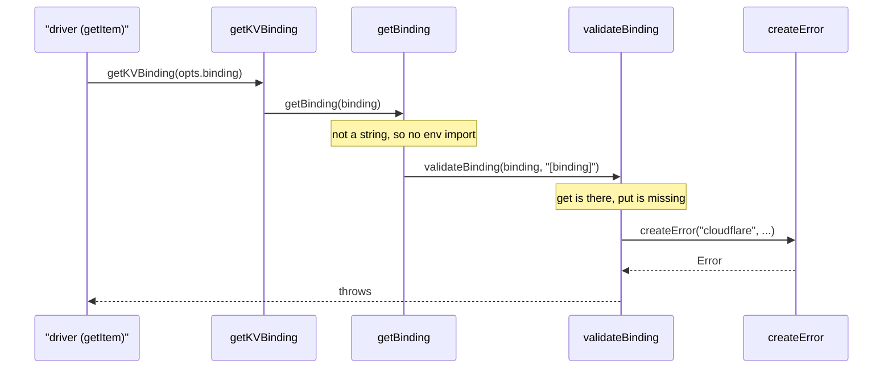

# unstorage-trace-001: A Cloudflare KV binding that cannot write

**Answer (in order):**

1. `src/drivers/cloudflare-kv-binding.ts#driver`
2. `src/drivers/utils/cloudflare.ts#getKVBinding`
3. `src/drivers/utils/cloudflare.ts#getBinding`
4. `src/drivers/utils/cloudflare.ts#validateBinding`
5. `src/drivers/utils/index.ts#createError`

## The flow



## Step by step

1. **`driver` to `getKVBinding`.** The factory returns an object literal, so `getItem` has no symbol and its calls belong to `driver`. Before it reads anything, `getItem` asks for the binding:

   ```ts
   // src/drivers/cloudflare-kv-binding.ts:51-55
   async getItem(key) {
     key = r(key);
     const binding = await getKVBinding(opts.binding);
     return binding.get(key);
   },
   ```

   `r(key)` is a local arrow function. It calls `joinKeys` only when `opts.base` is set, and it never leads to an error.

2. **`getKVBinding` to `getBinding`.** A thin wrapper whose only job is to supply the default binding name `"STORAGE"` (src/drivers/utils/cloudflare.ts:44-48).

3. **`getBinding` to `validateBinding`.** A binding that isn't a string is validated straight away. The string branch, which imports `env` from `cloudflare:workers` through `importEnv`, isn't taken:

   ```ts
   // src/drivers/utils/cloudflare.ts:20-25
   export function getBinding<T extends Binding>(binding: T | string): T | Promise<T> {
     if (typeof binding !== "string") {
       return validateBinding(binding, "[binding]");
     }
     return importEnv().then((env) => validateBinding(env?.[binding] as T, binding));
   }
   ```

4. **`validateBinding` to `createError`.** It checks for `get`, `put` and `delete`, in that order. `get` exists and `put` doesn't, so it throws on the second check:

   ```ts
   // src/drivers/utils/cloudflare.ts:32-39
   for (const key of ["get", "put", "delete"]) {
     if (!(key in binding)) {
       throw createError(
         "cloudflare",
         `Invalid binding \`${bindingName}\`: \`${key}\` key is missing`,
       );
     }
   }
   ```

5. **`createError`** (src/drivers/utils/index.ts:167-173) is where the `new Error(...)` is built, with the `[unstorage] [cloudflare]` prefix. `Error.captureStackTrace` then removes `createError` itself from the stack.

## Why other answers are wrong

- **Stopping at `validateBinding`:** it contains the `throw`, but the prompt asks for the function that *constructs* the `Error`, and that's `createError`.
- **Including `importEnv`:** only reached when `opts.binding` is a string. The prompt makes it an object.
- **Including `joinKeys`:** `r` calls it only when `opts.base` is set, and it never leads to the error.
- **Including `getR2Binding`:** that's the R2 driver's wrapper. The KV driver imports only `getKVBinding`.
- **Picking `src/utils.ts#joinKeys` or anything else in `src/utils.ts`:** drivers import their helpers from `src/drivers/utils/`, which has its own `normalizeKey` and `joinKeys`. Going to the definition, rather than searching by name, keeps you in the right file.

## Design notes

- Every driver reports errors through the shared `createError` and `createRequiredError` helpers, so every message starts with `[unstorage] [<driver>]`. That's why almost any driver error trace ends in `src/drivers/utils/index.ts`.
- The binding is looked up on every call, not once in the factory. That lets the same driver work with a binding object passed in directly, or with a name looked up in the Workers `env` when a request runs.

## Takeaways

- A factory that returns an object literal hides its methods from the symbol index. When a trace starts in one, its calls are credited to the factory, so read the method bodies but list the factory.
- Libraries that ship drivers separately often have same-named helpers in different folders (`src/utils.ts` and `src/drivers/utils/index.ts`). Follow the imports, not the names.
