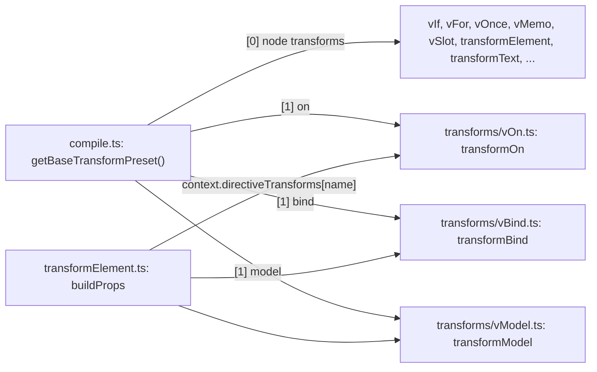

# vue-architecture-001: Directive transforms in the base compiler preset

**Answer:**
- `packages/compiler-core/src/transforms/vBind.ts`
- `packages/compiler-core/src/transforms/vModel.ts`
- `packages/compiler-core/src/transforms/vOn.ts`

## How to navigate there

1. **Open the function and read its return type.** `getBaseTransformPreset` is in `packages/compiler-core/src/compile.ts`. Its return type tells you the shape before you read any code:

   ```ts
   // packages/compiler-core/src/compile.ts:27-30
   export type TransformPreset = [
     NodeTransform[],
     Record<string, DirectiveTransform>,
   ]
   ```

   So the answer is the second tuple element, the `Record<string, DirectiveTransform>`.

2. **Find the record in the return value.** The first element is a long array with spreads and build flags. Skip past it. The second element is a short object literal:

   ```ts
   // packages/compiler-core/src/compile.ts:57-61
   {
     on: transformOn,
     bind: transformBind,
     model: transformModel,
   },
   ```

3. **Resolve each value through its import.** At the top of the file:

   ```ts
   // packages/compiler-core/src/compile.ts:16-17, 21
   import { transformOn } from './transforms/vOn'
   import { transformBind } from './transforms/vBind'
   import { transformModel } from './transforms/vModel'
   ```

4. **Confirm the type at each definition.** All three are declared as `DirectiveTransform`, not `NodeTransform`:
   - `export const transformOn: DirectiveTransform = (` at `vOn.ts:29`
   - `export const transformBind: DirectiveTransform = (dir, _node, context) => {` at `vBind.ts:15`
   - `export const transformModel: DirectiveTransform = (dir, node, context) => {` at `vModel.ts:23`

   That type annotation is the quickest way to tell the two kinds of transform apart when you browse `transforms/`.

## Module graph



## Node transforms vs. directive transforms

The compiler has two extension points, and this puzzle hinges on telling them apart.

| | Node transform | Directive transform |
|---|---|---|
| Type | `NodeTransform` | `DirectiveTransform` |
| Called with | `(node, context)` | `(dir, node, context)` |
| Registered in | the array, element `[0]` | the record, element `[1]`, keyed by directive name |
| Called by | `traverseNode`, for every node | `buildProps` in `transformElement.ts`, once per directive prop |
| Examples | `transformIf`, `transformFor`, `transformElement` | `transformOn`, `transformBind`, `transformModel` |

The lookup that uses the record is in `buildProps`:

```ts
// packages/compiler-core/src/transforms/transformElement.ts:699-702
const directiveTransform = context.directiveTransforms[name]
if (directiveTransform) {
  // has built-in directive transform.
  const { props, needRuntime } = directiveTransform(prop, node, context)
```

Structural directives like `v-if` and `v-for` change the shape of the tree, so they must run as node transforms during the walk. Directives like `v-on`, `v-bind` and `v-model` only turn into props on an element, so they are looked up by name while the element's props are built.

## Why the other files are wrong

- **`vIf.ts`, `vFor.ts`** define `transformIf` and `transformFor`. Both are `NodeTransform`s built with `createStructuralDirectiveTransform`, and they sit in the array, not the record. They handle directives, which is why they are tempting.
- **`vOnce.ts`, `vMemo.ts`** define `transformOnce` and `transformMemo`, which are also node transforms in the array.
- **`vSlot.ts`** supplies `trackSlotScopes` and `trackVForSlotScopes` to the array. It has no directive transform for `v-slot`. Its `buildSlots` function is called from `transformElement` (`transformElement.ts:178`) rather than registered by name.
- **`transformVBindShorthand.ts`** has "VBind" in its name, but it exports a `NodeTransform` that is the first entry of the array.
- **`noopDirectiveTransform.ts`** is a `DirectiveTransform`, but the base preset does not register it. `compiler-dom` uses it for `cloak`.
- **`transformElement.ts`** is the consumer of the record, not one of its entries.
- **`packages/compiler-dom/src/transforms/vOn.ts` and `vModel.ts`** define functions with the same names, but they are in a different package. They are registered in `DOMDirectiveTransforms` in `packages/compiler-dom/src/index.ts`.

## Takeaways

- Read a function's return type before its body. Here the `TransformPreset` tuple type tells you exactly which half of a 30-line return value matters.
- When a directory mixes two kinds of plugin, the type annotation on each export (`NodeTransform` vs `DirectiveTransform`) is a faster classifier than the file name.
- A record keyed by name is a registry. Find the code that indexes it (`context.directiveTransforms[name]`) to learn when its entries run.
