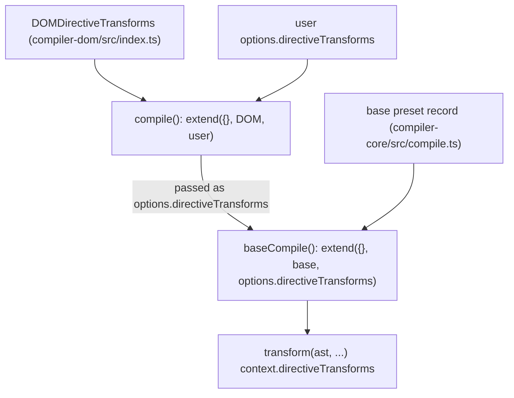

# vue-architecture-003: Registry of DOM-only directive transforms

**Answer:** `packages/compiler-dom/src/index.ts`

## How to navigate there

1. **Start at `compile` in `packages/compiler-dom/src/`.** It is in the package entry file, `index.ts`. The prompt says the record is merged into the options passed to the base compiler, so look at the `baseCompile(...)` call and its `directiveTransforms` key:

   ```ts
   // packages/compiler-dom/src/index.ts:57-61
   directiveTransforms: extend(
     {},
     DOMDirectiveTransforms,
     options.directiveTransforms || {},
   ),
   ```

2. **Go to the definition of `DOMDirectiveTransforms`.** It is a module-level constant in the same file, a few lines above `compile`:

   ```ts
   // packages/compiler-dom/src/index.ts:33-40
   export const DOMDirectiveTransforms: Record<string, DirectiveTransform> = {
     cloak: noopDirectiveTransform,
     html: transformVHtml,
     text: transformVText,
     model: transformModel, // override compiler-core
     on: transformOn, // override compiler-core
     show: transformShow,
   }
   ```

   This is the record. To register another DOM-only directive transform, you add a key here. The transform itself would usually go in its own file under `packages/compiler-dom/src/transforms/`, imported at the top of `index.ts` like the others (lines 14-18).

## How the records are layered

There are three sources of directive transforms, merged in two steps. Later sources win on key collisions.



The second step is in `baseCompile`:

```ts
// packages/compiler-core/src/compile.ts:113-117
directiveTransforms: extend(
  {},
  directiveTransforms,
  options.directiveTransforms || {}, // user transforms
),
```

So the final record for a DOM compile is:

| Key | Comes from | Notes |
|---|---|---|
| `bind` | compiler-core | Not overridden by the DOM layer. |
| `on` | compiler-dom | Overrides core. The DOM version handles event modifiers. |
| `model` | compiler-dom | Overrides core. The DOM version handles `<input>`, `<select>` and so on. |
| `cloak`, `html`, `text`, `show` | compiler-dom | DOM-only. |

That is why the `// override compiler-core` comments are true: the DOM record is passed as `options.directiveTransforms`, which `baseCompile` spreads *after* its own preset.

## Why the other files are wrong

- **`packages/compiler-core/src/compile.ts`** holds the base record (`on`, `bind`, `model`) inside `getBaseTransformPreset`. It is shared with every target, including SSR, and is not DOM-specific. Adding a DOM directive there would make it available to non-DOM compilers too.
- **`packages/compiler-dom/src/transforms/vShow.ts`, `vHtml.ts`, `vText.ts`, `vOn.ts`, `vModel.ts`** each define one transform function. None of them builds the record. A new transform file would not be picked up until it is added to `DOMDirectiveTransforms`.
- **`DOMNodeTransforms`** in the same `index.ts` (lines 27-31) is the DOM *node*-transform list. It is a different extension point, but it lives in the same file. If you picked `index.ts` for that reason you got the right file for the wrong reason.
- **`packages/compiler-dom/src/parserOptions.ts`** configures parsing (which tags are void, how to decode entities and so on). It does not hold transforms.
- **`packages/compiler-ssr/src/index.ts`** builds its own directive-transform record for SSR (`bind`, `on`, `model: ssrTransformModel`, `show: ssrTransformShow`, ...). It is outside `packages/compiler-dom/src/`.
- **`packages/compiler-ssr/src/transforms/ssrTransformComponent.ts`** imports `DOMDirectiveTransforms` and spreads it to build `vnodeDirectiveTransforms`. It reuses the record but does not define it.

## Background

Vue's compiler is split by target. `compiler-core` knows nothing about the DOM. `compiler-dom` wraps `baseCompile` with DOM parser options and DOM transforms. `compiler-ssr` wraps it differently again. Exporting `DOMDirectiveTransforms` as a named constant, rather than inlining it in `compile`, lets `compiler-ssr` reuse the same DOM transforms when it needs to build vnode-based fallback branches.

## Takeaways

- An "extension point" is usually a plain data structure (array, record, map) that some function reads. Find the read site, then jump to the definition of the value being read.
- With layered `extend({}, a, b)` or `{...a, ...b}` merges, write down the order. The last layer wins, and that tells you which package can override which.
- Exported constants that look like they could be inlined are often exported because another package reuses them. Find-references will show you who.
