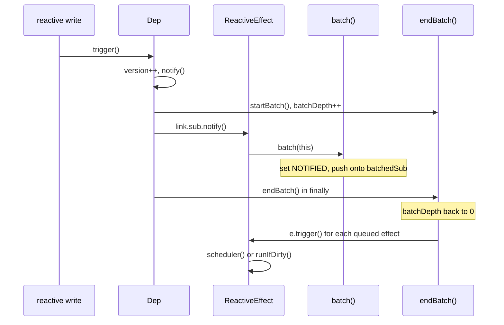

# vue-find-001: Deferring a notified effect

**Answer:** `packages/reactivity/src/effect.ts#batch`

## How to navigate there

1. **Open `ReactiveEffect.notify`.** In `packages/reactivity/src/effect.ts`, search for `notify(): void`. The method is short:

   ```ts
   // packages/reactivity/src/effect.ts:150-160
   notify(): void {
     if (
       this.flags & EffectFlags.RUNNING &&
       !(this.flags & EffectFlags.ALLOW_RECURSE)
     ) {
       return
     }
     if (!(this.flags & EffectFlags.NOTIFIED)) {
       batch(this)
     }
   }
   ```

   The second `if` matches the prompt's "unless the effect is already marked as notified". The call inside it is the hand-off.

2. **Jump to `batch` and check it does what the prompt says.**

   ```ts
   // packages/reactivity/src/effect.ts:251-260
   export function batch(sub: Subscriber, isComputed = false): void {
     sub.flags |= EffectFlags.NOTIFIED
     if (isComputed) {
       sub.next = batchedComputed
       batchedComputed = sub
       return
     }
     sub.next = batchedSub
     batchedSub = sub
   }
   ```

   - "marks it as notified": `sub.flags |= EffectFlags.NOTIFIED`.
   - "chains it onto a pending list": `sub.next = batchedSub; batchedSub = sub`. The list is an intrusive singly linked list. The `next` field lives on the subscriber itself, so no array is allocated.
   - "to be run later": nothing in `batch` runs the effect.

   It is module-level (a top-level `export function`), in the same file, as the prompt requires.

## Where it fits



`Dep.notify` in `packages/reactivity/src/dep.ts` wraps the whole loop in `startBatch()` and `endBatch()` (lines 174 and 202). That is why `notify` can defer: it knows somebody up the stack will close the batch and drain the list.

## A detail worth noticing: the order trick

`Dep.notify` walks its subscribers from the tail backwards:

```ts
// packages/reactivity/src/dep.ts:193
for (let link = this.subs; link; link = link.prevSub) {
```

`batch` prepends each subscriber to `batchedSub`. Walking backwards and prepending cancel out, so `endBatch` sees the subscribers in their original subscription order. The `__DEV__` comment in `Dep.notify` says the same thing: subscribers are "notified and batched in reverse-order and then invoked in original order".

## Why the other candidates are wrong

| Candidate | What it does | Why it is not the answer |
|---|---|---|
| `startBatch` (line 265) | `batchDepth++` | Opens a batch. It does not take an effect and is not called from `notify`. |
| `endBatch` (line 273) | Decrements `batchDepth`, and at 0 drains `batchedComputed` and `batchedSub`, clearing `NOTIFIED` and calling `trigger()` | It runs the pending effects. It is the opposite of deferring. It is called by `Dep.notify`, not by `ReactiveEffect.notify`. |
| `ReactiveEffect.trigger` (line 206) | Calls the scheduler or `runIfDirty` | This is what eventually runs the effect. `notify` never calls it. |
| `ReactiveEffect.runIfDirty` / `run` | Re-run the effect function | Same reason. They run work, they do not queue it. |
| `ComputedRefImpl.notify` in `computed.ts` | Calls `batch(this, true)` | Same idea for computeds, but it is a method in a different file, and it calls `batch` rather than being the function `ReactiveEffect.notify` hands off to. |
| `Dep.notify` in `dep.ts` | Loops over subscribers and calls `sub.notify()` | It is upstream of `ReactiveEffect.notify`, in a different file. |
| `prepareDeps` / `cleanupDeps` | Dependency bookkeeping around `run` | Unrelated to notification. |

## Why Vue batches

Without batching, one reactive write could run an effect immediately, and that effect could write again, triggering more effects in the middle of the first notification loop. Collecting subscribers first and running them after the outermost batch closes means:

- An effect that depends on several deps written in the same batch is triggered once per drain, not once per write. The `NOTIFIED` flag stops it from being queued twice.
- Computeds are marked dirty first (the `batchedComputed` list is drained, but not triggered), and effects run only after that.
- Nested batches (`batchDepth > 1`) do nothing on `endBatch` until the outermost one finishes.

## Takeaways

- When a method "doesn't do the work", its last statement is usually the hand-off. Read it first.
- Intrusive linked lists (a `next` field on the item) are common in hot runtime code. If you see `x.next = head; head = x`, that is a push onto a stack-like list.
- A queue helper is only half the story. Find who drains it (`endBatch` here) to understand when the deferred work actually runs.
