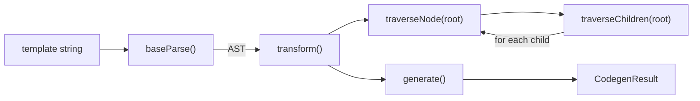

# vue-trace-001: From baseCompile into the AST walk

**Answer:** `baseCompile` -> `transform` -> `traverseNode` -> `traverseChildren`

- `packages/compiler-core/src/compile.ts#baseCompile`
- `packages/compiler-core/src/transform.ts#transform`
- `packages/compiler-core/src/transform.ts#traverseNode`
- `packages/compiler-core/src/transform.ts#traverseChildren`

## The big picture

`baseCompile` is a three-stage pipeline: parse, transform, generate. The puzzle asks you to enter the middle stage and follow it down to the loop over children.



The `traverseNode` and `traverseChildren` pair is mutually recursive. The trace stops the first time you reach `traverseChildren`.

## How to navigate there

1. **Read `baseCompile` top to bottom.** In `packages/compiler-core/src/compile.ts` (line 67), the body checks options, then:

   ```ts
   // packages/compiler-core/src/compile.ts:95-97
   const ast = isString(source) ? baseParse(source, resolvedOptions) : source
   const [nodeTransforms, directiveTransforms] =
     getBaseTransformPreset(prefixIdentifiers)
   ```

   then `transform(ast, extend({}, resolvedOptions, { nodeTransforms: [...], directiveTransforms: ... }))` at line 106, and finally `return generate(ast, resolvedOptions)` at line 121. The hint says the transform stage works on the AST the parser produced, so `transform` is the next step.

2. **`transform`** (`packages/compiler-core/src/transform.ts:334`) is short:

   ```ts
   // packages/compiler-core/src/transform.ts:334-342
   export function transform(root: RootNode, options: TransformOptions): void {
     const context = createTransformContext(root, options)
     traverseNode(root, context)
     if (options.hoistStatic) {
       cacheStatic(root, context)
     }
     if (!options.ssr) {
       createRootCodegen(root, context)
     }
   ```

   `traverseNode(root, context)` starts the walk.

3. **`traverseNode`** (line 425) first runs every node transform on the current node, collecting exit callbacks. Then it switches on the node type. The root of the AST is a `ROOT` node, which falls into this case:

   ```ts
   // packages/compiler-core/src/transform.ts:472-477
   case NodeTypes.IF_BRANCH:
   case NodeTypes.FOR:
   case NodeTypes.ELEMENT:
   case NodeTypes.ROOT:
     traverseChildren(node, context)
     break
   ```

4. **`traverseChildren`** (line 406) is the end condition. It is the function that loops over `parent.children`:

   ```ts
   // packages/compiler-core/src/transform.ts:414-422
   for (; i < parent.children.length; i++) {
     const child = parent.children[i]
     if (isString(child)) continue
     context.grandParent = context.parent
     context.parent = parent
     context.childIndex = i
     context.onNodeRemoved = nodeRemoved
     traverseNode(child, context)
   }
   ```

## Why other candidates are wrong

| Candidate | Called from | Why it is not in the chain |
|---|---|---|
| `baseParse` (`parser.ts`) | `baseCompile` | The parse stage. It builds the AST and returns. It never calls `transform`. |
| `getBaseTransformPreset` | `baseCompile` | Returns the arrays of transforms and returns. The transforms inside are invoked through `context.nodeTransforms[i](...)`, which the prompt excludes. |
| `generate` (`codegen.ts`) | `baseCompile` | The codegen stage. It runs after `transform` has returned. |
| `createTransformContext` | `transform` | Builds the context object and returns. It does not walk the tree. |
| `cacheStatic` | `transform` | Walks the tree after `traverseNode` is done, looking for static content to cache. It runs only when `hoistStatic` is set, and it is not the transform walk the prompt describes. |
| `createRootCodegen` | `transform` | Builds the root's `codegenNode` after the walk. It does not loop over children with `traverseNode`. |
| `transformElement`, `transformIf`, ... | `traverseNode`, through the array | Node transforms passed around in arrays. The prompt excludes them explicitly. |
| `context.helper` | `traverseNode` | Registers a runtime helper for `COMMENT` and `INTERPOLATION` nodes. Not on the path. |
| Stopping at `traverseNode` | | `traverseNode` does contain a loop in its `IF` case, but that loop is over `node.branches`, and the root is not an `IF` node. The loop over a parent's `children` is in `traverseChildren`. |
| `extend`, `isString` | `baseCompile` | Helpers from `@vue/shared`, a separate package. They are utilities, not steps of the walk. |

## Design notes

- **Enter and exit phases.** `traverseNode` collects the return values of node transforms as `exitFns`, walks the children, then calls the exit functions in reverse order (lines 481-485). This lets a transform like `transformElement` do its main work on the way back up, when all children have already been transformed.
- **The context is a cursor.** `traverseChildren` sets `context.parent`, `context.childIndex` and `context.onNodeRemoved` before each child. Transforms use these to replace or remove the current node. If a transform removes a node, `nodeRemoved` decrements `i` so the loop does not skip the next sibling.
- **Replacement is allowed.** After each node transform, `traverseNode` re-reads `context.currentNode` (lines 442-448). A structural transform such as `v-if` can swap the element for an `IF` node, and the rest of the walk continues on the new node.

## Takeaways

- Compilers are usually pipelines. Find the stage boundaries in the top-level function first, then dive into the one stage you care about.
- Tree walkers are often split into "visit one node" and "visit the children" functions that call each other. The prompt's end condition tells you which half to stop at.
- When the prompt excludes "functions passed around in arrays", it is telling you that calls like `nodeTransforms[i](node, context)` are not direct calls to any named function.
