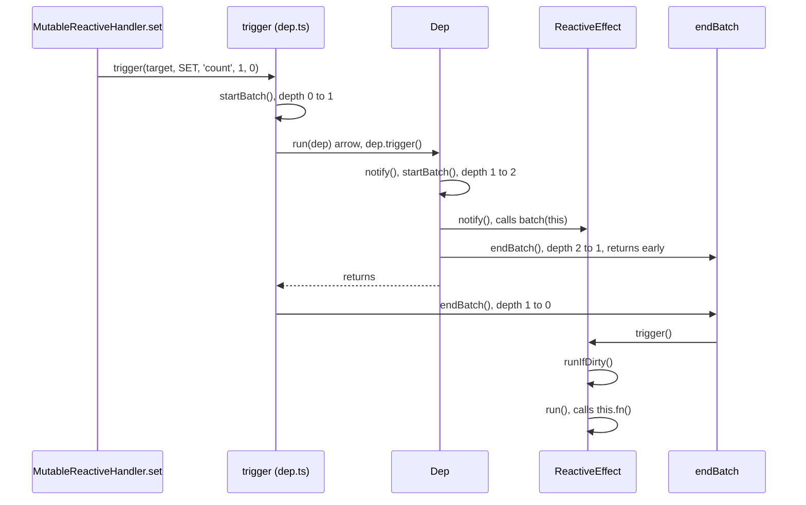

# vue-trace-002: Which endBatch re-runs the effect

**Answer:** `MutableReactiveHandler.set` -> `trigger` -> `endBatch` -> `ReactiveEffect.trigger` -> `ReactiveEffect.runIfDirty` -> `ReactiveEffect.run`

- `packages/reactivity/src/baseHandlers.ts#MutableReactiveHandler.set`
- `packages/reactivity/src/dep.ts#trigger`
- `packages/reactivity/src/effect.ts#endBatch`
- `packages/reactivity/src/effect.ts#ReactiveEffect.trigger`
- `packages/reactivity/src/effect.ts#ReactiveEffect.runIfDirty`
- `packages/reactivity/src/effect.ts#ReactiveEffect.run`

## The key idea: two phases

A write in Vue's reactivity system happens in two phases:

1. **Notify.** Every subscriber of the changed dep is marked and queued. Nothing runs.
2. **Run.** When the outermost batch closes, the queue is drained and the effects run.

The puzzle asks for the call stack at the moment the effect runs, so you need the phase-2 stack. Phase 1 has already returned by then. The trap is that both phases pass through a function named `endBatch`, and only one of those calls does anything.



## How to navigate there

1. **`MutableReactiveHandler.set`** (`packages/reactivity/src/baseHandlers.ts:142`). The key `count` already exists, so `hadKey` is true. The value changed from 0 to 1, so:

   ```ts
   // packages/reactivity/src/baseHandlers.ts:187-188
   } else if (hasChanged(value, oldValue)) {
     trigger(target, TriggerOpTypes.SET, key, value, oldValue)
   ```

2. **`trigger`** (`packages/reactivity/src/dep.ts:294`). The target was read by the effect, so `targetMap` has a deps map for it. `trigger` defines an inner arrow, `run`, that calls `dep.trigger()`. The body is bracketed by a batch:

   ```ts
   // packages/reactivity/src/dep.ts:323
   startBatch()
   ```

   ```ts
   // packages/reactivity/src/dep.ts:388
   endBatch()
   ```

   In between, the `SET` path calls `run(depsMap.get(key))` for the `count` dep.

3. **Phase 1, inside the batch.** `Dep.trigger` increments `this.version` and calls `this.notify()`. `Dep.notify` opens its own batch, calls `link.sub.notify()` on each subscriber, and closes it in `finally`. `ReactiveEffect.notify` just calls `batch(this)`. When `Dep.notify` calls `endBatch()`, `batchDepth` drops from 2 to 1, and this line returns immediately:

   ```ts
   // packages/reactivity/src/effect.ts:273-276
   export function endBatch(): void {
     if (--batchDepth > 0) {
       return
     }
   ```

   Everything in phase 1 then returns to `trigger`.

4. **Phase 2, `trigger`'s own `endBatch()`.** Now `--batchDepth` reaches 0, so `endBatch` drains `batchedSub`:

   ```ts
   // packages/reactivity/src/effect.ts:297-300
   if (e.flags & EffectFlags.ACTIVE) {
     try {
       // ACTIVE flag is effect-only
       ;(e as ReactiveEffect).trigger()
   ```

5. **`ReactiveEffect.trigger`** (line 206). The effect is not paused and has no scheduler, because `effect(fn)` was called without options. So it takes the last branch, `this.runIfDirty()`.

6. **`ReactiveEffect.runIfDirty`** (line 219) calls `isDirty(this)`. The link stored the dep's old version when the effect last ran, and `Dep.trigger` has bumped the dep's version since, so `link.dep.version !== link.version` and `isDirty` returns true. Then it calls `this.run()`.

7. **`ReactiveEffect.run`** (line 162) sets `activeSub = this`, prepares deps, and calls `this.fn()` inside `try` (line 179). That is the end condition.

## batchDepth, step by step

| Step | Call | `batchDepth` after | Effect |
|---|---|---|---|
| 1 | `trigger` -> `startBatch()` | 1 | |
| 2 | `Dep.notify` -> `startBatch()` | 2 | |
| 3 | `ReactiveEffect.notify` -> `batch(this)` | 2 | effect flagged `NOTIFIED`, queued on `batchedSub` |
| 4 | `Dep.notify` -> `endBatch()` | 1 | `--batchDepth > 0`, returns at once |
| 5 | `trigger` -> `endBatch()` | 0 | drains `batchedSub`, calls `ReactiveEffect.trigger()` |

## Why other candidates are wrong

- **`set -> trigger -> Dep.trigger -> Dep.notify -> endBatch -> ...`** is a real chain of calls in the code, but `Dep.notify`'s `endBatch` is the nested one at step 4. It returns without running anything, so that stack is gone before the effect runs.
- **`Dep.trigger` between `trigger` and `endBatch`** is wrong for a second reason too: `trigger` does not call `dep.trigger()` from its own body. It calls it from the inner `run` arrow, which the prompt skips, and that call has returned by the time `endBatch` runs.
- **`Dep.notify -> ReactiveEffect.notify -> batch`** is the notify phase. `batch` sets a flag and links the effect into a list. It never calls `run`.
- **`isDirty`** is called by `runIfDirty`, but it returns before `run` is called. It is not on the stack when `fn` runs.
- **Stopping at `runIfDirty`** is one step short. It decides whether to run. `run` is the method that calls `fn`.
- **`ReactiveEffect.scheduler`** is not used. With no options, `scheduler` is `undefined`. A component render effect or a `watch` would go through a scheduler instead, and the chain would be different.
- **`startBatch`** is called, but it only increments a counter and returns.
- **`Reflect.set`, `hasChanged`, `toRaw`** are standard-library or utility calls before `trigger`, and none of them is on the stack when `fn` runs.

## Design notes

- **Why nest batches?** `trigger` may call `run(dep)` several times for one write: the key's dep, then the iterate dep for `ADD` and `DELETE`, the array-iterate dep for array indices, and so on. Opening one batch around all of them means an effect that depends on several of those deps is queued once (the `NOTIFIED` flag stops a second `batch` call) and runs once, after every dep has been notified.
- **`Dep.notify` still opens its own batch** because it can be called from other places, such as `RefImpl`'s setter, where no outer batch exists. With the nesting counter, it is safe either way.
- **Version numbers instead of dirty flags.** `isDirty` compares versions on each link, so an effect queued but whose deps did not actually change is skipped by `runIfDirty`.

## Takeaways

- "What is on the stack when X happens" is a different question from "what calls lead to X." Deferred work means part of the call chain has returned before X runs.
- When you see a depth counter (`batchDepth`, `depth`, `nesting`), count it at every increment and decrement. Only the call that returns it to zero does the real work.
- Inner arrow functions like `trigger`'s `run` matter for reading the code, but not for a named-function trace. Note them and skip them.
