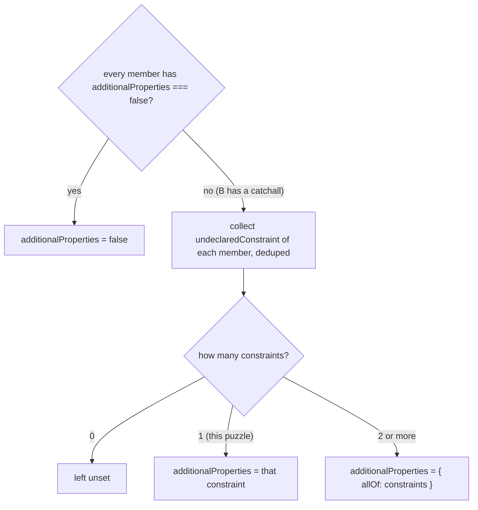

# zod-architecture-001: Folding a closed object with a catchall object

**Answer:** a, `{ type: "string" }`, the constraint taken from member B.

## The inputs

```text
Member A: { type: "object", properties: { a: { type: "string" } },
            required: ["a"], additionalProperties: false }          ← closed object
Member B: { type: "object", properties: { b: { type: "number" } },
            additionalProperties: { type: "string" } }              ← catchall(z.string())
```

Everything happens in `foldObjects` and its helper `undeclaredConstraint`, both in `packages/zod/src/v4/core/to-json-schema.ts`.

## Step 1: the helper, `undeclaredConstraint`

Read the helper first, because it is used twice and it decides the answer.

```ts
// packages/zod/src/v4/core/to-json-schema.ts:474-478
function undeclaredConstraint(member: JSONSchema.ObjectSchema): JSONSchema.BaseSchema | null {
  const extra = member.additionalProperties;
  if (extra === undefined || extra === false || typeof extra !== "object" || extra === null) return null;
  return Object.keys(extra).length ? (extra as JSONSchema.BaseSchema) : null;
}
```

It answers: "what does this member demand of a key it does not declare?" `false` counts as *no constraint* here, not as "reject". Only a non-empty schema object counts.

| Member | `additionalProperties` | `undeclaredConstraint` returns |
|---|---|---|
| A | `false` | `null` |
| B | `{ type: "string" }` | `{ type: "string" }` |

## Step 2: both members are accepted

The first loop (lines 483-490) returns `null` if a member is not `type: "object"` or has any key outside `FOLDABLE_KEYS`, which is `type`, `properties`, `required` and `additionalProperties` (line 470). Both members use only those keys, so both are pushed onto `objects`. The prompt also says so.

## Step 3: merge properties and required

This part is not asked about, but it shows the same rule at work:

| Key | From A | From B | Merged |
|---|---|---|---|
| `a` | `{ type: "string" }` (declared) | `{ type: "string" }` (B's catchall, via `undeclaredConstraint`) | duplicates removed by `JSON.stringify` comparison, one part, `{ type: "string" }` |
| `b` | A does not declare it; `undeclaredConstraint(A)` is `null`, so skipped | `{ type: "number" }` | `{ type: "number" }` |

`required` becomes `["a"]`.

## Step 4: decide `additionalProperties`

```ts
// packages/zod/src/v4/core/to-json-schema.ts:517-527
if (objects.every((object) => object.additionalProperties === false)) {
  folded.additionalProperties = false;
} else {
  const constraints: JSONSchema.BaseSchema[] = [];
  for (const object of objects) {
    const constraint = undeclaredConstraint(object);
    if (constraint && !constraints.some((seen) => JSON.stringify(seen) === JSON.stringify(constraint)))
      constraints.push(constraint);
  }
  if (constraints.length === 1) folded.additionalProperties = constraints[0]!;
  else if (constraints.length > 1) folded.additionalProperties = { allOf: constraints };
}
```

1. `objects.every(... === false)`: A is `false`, B is an object. **False**, so take the `else` branch.
2. Collect constraints: A gives `null` (skipped), B gives `{ type: "string" }`. `constraints = [{ type: "string" }]`.
3. `constraints.length === 1`, so `folded.additionalProperties = { type: "string" }`.



## Why the other choices are wrong

| Choice | When it would be right | Why not here |
|---|---|---|
| b, left unset | No member has a catchall and not every member is closed (for example, two plain open objects). | B has a non-empty catchall, so one constraint is collected. |
| c, `{ allOf: [{ type: "string" }] }` | Two or more *distinct* constraints were collected. | Only one constraint exists. A single constraint is assigned directly, never wrapped. |
| d, `false` | Every member is closed. | Only A is closed. Being closed in one member is not enough. |

The tempting wrong answer is d: "A is closed, so the merged object must be closed." That is how a plain `allOf` would behave in JSON Schema, where each member applies its own `additionalProperties` separately. Zod's fold deliberately does something else.

## Why Zod folds it this way

The doc comment on `foldIntersection` (lines 532-537) explains the reason. In JSON Schema, `additionalProperties` inside one `allOf` member only sees that member's own `properties`, so two closed objects in an `allOf` would reject each other's keys. Zod's parser does not work that way. It pools the keys of both sides and reports a key as unrecognized only when *every* side rejects it (the comment cites `handleIntersectionResults`). To make the emitted JSON Schema match the parser, Zod merges the members into one object, and the merged rule for unknown keys is:

- closed only if every member is closed (line 516 comment: "A key no member declares is rejected only when every member rejects it"),
- otherwise, an unknown key must satisfy whatever the catchall members demand.

For this input, a key like `c` is not declared by either member. A alone would reject it, but B accepts any string, so the merged object accepts `c` when it is a string.

## Takeaways

- Read small helpers before the main function. Here `undeclaredConstraint` maps `false` to `null`, and that one line decides the answer.
- When a function has an "all of them" check followed by an `else`, evaluate the check first with the concrete inputs before reading the `else` body.
- Code that converts between two systems (Zod's parser semantics and JSON Schema's semantics) often looks odd until you know which side's meaning it is preserving. Doc comments on the entry function usually say which.
