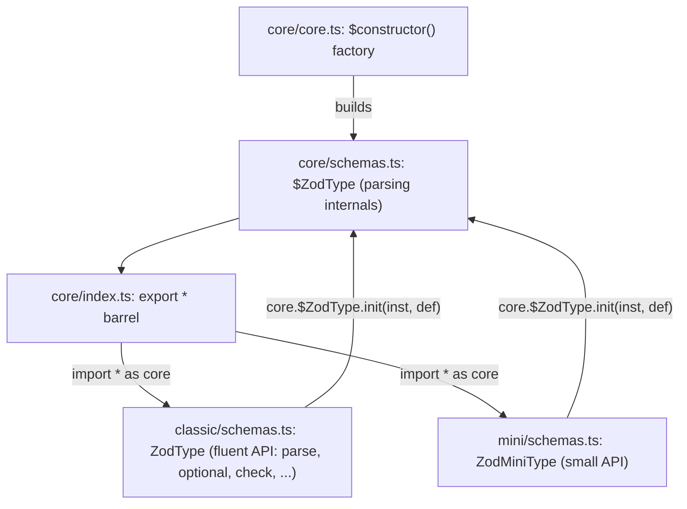

# zod-architecture-002: The core base of the classic ZodType

**Answer:** `packages/zod/src/v4/core/schemas.ts`

## How to navigate there

1. **Find the call.** In `packages/zod/src/v4/classic/schemas.ts`, `ZodType` is built with `core.$constructor`, and its initializer starts by initializing the core layer:

   ```ts
   // packages/zod/src/v4/classic/schemas.ts:173-177
   export const ZodType: core.$constructor<ZodType> = /*@__PURE__*/ core.$constructor<ZodType>(
     "ZodType",
     (inst, def) => {
       _ensureDefaultLocale();
       core.$ZodType.init(inst, def);
   ```

2. **Resolve `core`.** At the top of the file:

   ```ts
   // packages/zod/src/v4/classic/schemas.ts:2
   import * as core from "../core/index.js";
   ```

   So `core.$ZodType` is whatever `packages/zod/src/v4/core/index.ts` exports under that name.

3. **Follow the barrel.** `core/index.ts` has no definitions of its own. It is a list of `export * from "./core.js"`, `export * from "./schemas.js"`, `export * from "./checks.js"`, and so on. You have to find which of those files declares `$ZodType`. A search for `export const $ZodType` in `packages/zod/src/v4/` finds exactly one hit:

   ```ts
   // packages/zod/src/v4/core/schemas.ts:203-205
   export const $ZodType: core.$constructor<$ZodType> = /*@__PURE__*/ core.$constructor<$ZodType>(
     "$ZodType",
     (inst, def) => {
   ```

   Its initializer sets `inst._zod.def`, `inst._zod.bag` and `inst._zod.version`, runs each check's `onattach` hooks, and wires `inst._zod.run` (directly to `_zod.parse` when there are no checks, or through a `runChecks` wrapper when there are).

## Two names, one file

`packages/zod/src/v4/core/schemas.ts` declares `$ZodType` twice:

| Line | Declaration | Kind |
|---|---|---|
| 192 | `export interface $ZodType<...>` | type |
| 203 | `export const $ZodType: core.$constructor<$ZodType> = ...` | value |

The prompt asks for the *constructor value*, but since both are in the same file the file answer is the same. In an expression like `core.$ZodType.init(...)`, TypeScript resolves the name to the value.

## The layering



Zod v4 has one core and two public APIs. Both `ZodType` in `classic/` and `ZodMiniType` in `mini/schemas.ts` (line 45) call `core.$ZodType.init(inst, def)` from their own initializers. This is how traits compose without class inheritance: each layer's `init` adds its trait name to `inst._zod.traits` and runs its initializer on the same object.

## How `$constructor` makes `.init` exist

`$constructor` in `packages/zod/src/v4/core/core.ts:51` returns a constructor-like function with an `init(inst, def)` method attached. `init` creates `inst._zod` if needed, returns early if this trait is already applied (`inst._zod.traits.has(name)`), records the trait, and runs the initializer. Calling `core.$ZodType.init(inst, def)` from `ZodType`'s initializer therefore applies the core trait to the classic instance first, then the classic initializer adds `inst.def` and `inst.type`.

## Why the other files are wrong

| File | Why it is wrong |
|---|---|
| `packages/zod/src/v4/core/core.ts` | Defines `$constructor`, the factory used to build `$ZodType` and every other trait. It does not define `$ZodType`. |
| `packages/zod/src/v4/core/index.ts` | Re-exports `./schemas.js` with `export *`. It contains no definition. This is where "go to definition" may stop first. |
| `packages/zod/src/v4/classic/schemas.ts` | Defines the classic `ZodType`, the caller. It is also outside `core/`. |
| `packages/zod/src/v4/mini/schemas.ts` | Defines `ZodMiniType`, a second wrapper around the same core trait. Outside `core/`. |
| `packages/zod/src/v4/core/checks.ts` | Defines `$ZodCheck` and the check traits. They are built with the same `$constructor`, and `$ZodType`'s initializer reads `inst._zod.traits.has("$ZodCheck")`, but `$ZodType` is not defined here. |
| `packages/zod/src/v4/core/api.ts` | Defines factory functions such as `_string` and `_minLength` that create schemas and checks. No `$ZodType` definition. |
| `packages/zod/src/v3/types.ts` | Zod v3's `ZodType` class, a different, older implementation outside `v4/core/`. |

## Takeaways

- A namespace import (`import * as core from ".../index.js"`) plus a barrel file of `export *` lines is a two-hop lookup. Search for `export const <Name>` across the package to skip the barrel.
- TypeScript allows a type and a value with the same name. Note which one a puzzle (or a call site) refers to.
- Libraries that offer several API flavors usually keep one shared core. Find the call from the outer layer into the core, here `core.$ZodType.init`, and you have found the layer boundary.
