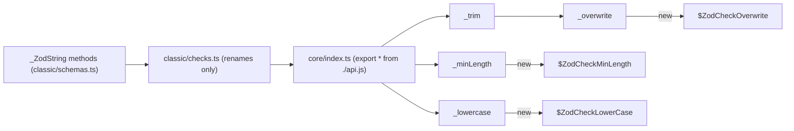

# zod-architecture-003: The checks behind a string chain

**Answer:**
- `packages/zod/src/v4/core/checks.ts#$ZodCheckMinLength~2`
- `packages/zod/src/v4/core/checks.ts#$ZodCheckOverwrite~2`
- `packages/zod/src/v4/core/checks.ts#$ZodCheckLowerCase~2`

The `~2` suffix picks the second symbol of that name in the file. Each name is declared first as an `export interface` and then as an `export const ... = core.$constructor(...)`. The constant is the second one, and it is the only one a `new` expression can target.

## The three paths at a glance

| Chain call | Classic method (`classic/schemas.ts`) | Classic name -> core function | `new` expression in `core/api.ts` | Constructor in `core/checks.ts` |
|---|---|---|---|---|
| `.min(3)` | `min(...args)` -> `checks.minLength(...)` | `_minLength as minLength` | `new checks.$ZodCheckMinLength(...)` in `_minLength` (1039) | `$ZodCheckMinLength`, line 606 |
| `.trim()` | `trim()` -> `checks.trim()` | `_trim as trim` | `_trim` calls `_overwrite(...)`, which does `new checks.$ZodCheckOverwrite(...)` (1167) | `$ZodCheckOverwrite`, line 1190 |
| `.lowercase()` | `lowercase(params)` -> `checks.lowercase(params)` | `_lowercase as lowercase` | `new checks.$ZodCheckLowerCase(...)` in `_lowercase` (1073) | `$ZodCheckLowerCase`, line 848 |



## How to navigate there

1. **Find the string methods.** `z.string()` calls `core._string(ZodString, params)`. The `ZodString` initializer runs `_ZodString.init(inst, def)` (`classic/schemas.ts:533`), and `_ZodString` (line 388) holds the methods:

   ```ts
   // packages/zod/src/v4/classic/schemas.ts:415-416, 427-428, 433-434
   min(...args) {
     return this.check((checks.minLength as any)(...args));
   },
   lowercase(params) {
     return this.check(checks.lowercase(params));
   },
   trim() {
     return this.check(checks.trim());
   },
   ```

2. **Resolve `checks`.** In this file, `checks` is `import * as checks from "./checks.js"` (line 10), the *classic* checks module. As the hint says, it only renames core functions:

   ```ts
   // packages/zod/src/v4/classic/checks.ts:15, 18, 28
   _minLength as minLength,
   _lowercase as lowercase,
   _trim as trim,
   ```

   They come `from "../core/index.js"`, which does `export * from "./api.js"`.

3. **Read the three functions in `core/api.ts`.**

   ```ts
   // packages/zod/src/v4/core/api.ts:1035-1044
   export function _minLength(
     minimum: number,
     params?: string | $ZodCheckMinLengthParams
   ): checks.$ZodCheckMinLength<util.HasLength> {
     return new checks.$ZodCheckMinLength({
       check: "min_length",
       ...util.normalizeParams(params),
       minimum,
     });
   }
   ```

   ```ts
   // packages/zod/src/v4/core/api.ts:1166-1171, 1180-1182
   export function _overwrite<T>(tx: (input: T) => T): checks.$ZodCheckOverwrite<T> {
     return new checks.$ZodCheckOverwrite({
       check: "overwrite",
       tx,
     }) as checks.$ZodCheckOverwrite<T>;
   }
   ...
   export function _trim(): checks.$ZodCheckOverwrite<string> {
     return _overwrite((input) => input.trim());
   }
   ```

   ```ts
   // packages/zod/src/v4/core/api.ts:1072-1078
   export function _lowercase(params?: string | $ZodCheckLowerCaseParams): checks.$ZodCheckLowerCase {
     return new checks.$ZodCheckLowerCase({
       check: "string_format",
       format: "lowercase",
       ...util.normalizeParams(params),
     });
   }
   ```

   `.trim()` is the one with an extra hop: `_trim` does not use `new` itself. It delegates to `_overwrite`, and the `new` is there.

4. **Pick the constants, not the interfaces.** In `core/checks.ts`, for example:

   ```ts
   // packages/zod/src/v4/core/checks.ts:1186, 1190-1192
   export interface $ZodCheckOverwrite<T = unknown> extends $ZodCheck<T> {
   ...
   export const $ZodCheckOverwrite: core.$constructor<$ZodCheckOverwrite> = /*@__PURE__*/ core.$constructor(
     "$ZodCheckOverwrite",
     (inst, def) => {
   ```

## Why the other candidates are wrong

| Candidate | Why it is wrong |
|---|---|
| `$ZodCheckMinLength`, `$ZodCheckOverwrite`, `$ZodCheckLowerCase` without `~2` | Those are the interfaces. They are types and cannot be the target of `new`. |
| `$ZodCheckStringFormat` (line 737) | `$ZodCheckLowerCase`'s initializer sets `def.pattern ??= regexes.lowercase` and calls `$ZodCheckStringFormat.init(inst, def)`. It is a base trait initialized from inside another check, which the prompt excludes. No `new` targets it in this chain. |
| `$ZodCheck` (line 32) | The base of every check. `$ZodCheckMinLength` and `$ZodCheckOverwrite` call `$ZodCheck.init(inst, def)`. Same exclusion. |
| `$ZodCheckGreaterThan` | What `.min()` creates on number, bigint and date schemas, through `_gte`. The string `.min()` calls `_minLength`. |
| `$ZodCheckMinSize` | Created by `_minSize`, used for sets and files. |
| A `$ZodCheckTrim` | It does not exist as code. `checks.ts` has a commented-out `$ZodCheckTrim` block just below `$ZodCheckOverwrite`. Trimming is an overwrite check with a `tx` function. |
| A second `$ZodCheckOverwrite` for `.lowercase()` | That would be `.toLowerCase()`, which calls `_toLowerCase` -> `_overwrite(...)` and transforms the value. `.lowercase()` validates against a regex and does not change the value. |
| `ZodType.check` / `clone` | `this.check(...)` clones the schema with the new check appended to `def.checks`. It creates a schema, not a check. |
| `$ZodString` | The core string schema, created by `z.string()`, not by a chained method. |

## Background: checks that validate vs. checks that transform

All three are "checks" in Zod's model, but they do different things when the schema runs:

- `$ZodCheckMinLength` reads `payload.value` and adds an issue if it is too short.
- `$ZodCheckLowerCase` is a string-format check that tests a regex.
- `$ZodCheckOverwrite` sets `payload.value = def.tx(payload.value)` (`checks.ts:1195-1197`). It changes the value in place, so later checks see the trimmed string.

Order therefore matters. In `z.string().min(3).trim().lowercase()`, the length check runs on the untrimmed input, and the lowercase check runs on the trimmed one.

## Takeaways

- Fluent APIs often go through several thin layers (method -> renamed export -> barrel -> factory). Follow each hop with "go to definition" until you reach a `new`.
- One factory delegating to another (`_trim` -> `_overwrite`) is easy to miss. If a factory has no `new`, read the function it returns from.
- Same-named interface and constant pairs are common in TypeScript libraries. Symbol IDs like `~2` tell them apart, and only the value can be constructed.
