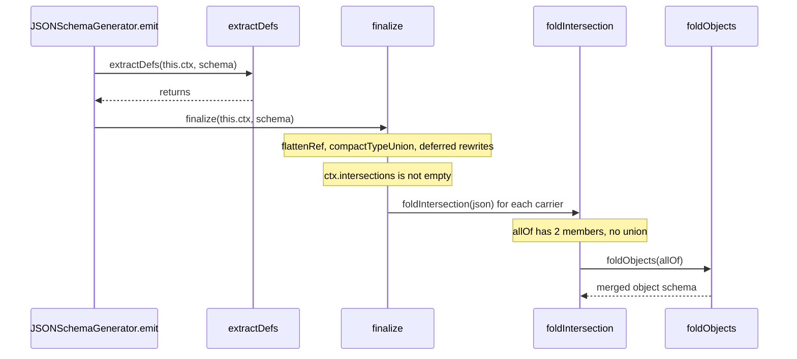

# zod-trace-001: From emit to merging intersection members

**Answer:** `JSONSchemaGenerator.emit` -> `finalize` -> `foldIntersection` -> `foldObjects`

- `packages/zod/src/v4/core/json-schema-generator.ts#JSONSchemaGenerator.emit`
- `packages/zod/src/v4/core/to-json-schema.ts#finalize`
- `packages/zod/src/v4/core/to-json-schema.ts#foldIntersection`
- `packages/zod/src/v4/core/to-json-schema.ts#foldObjects`

## The call chain



## How to navigate there

1. **`emit`** in `packages/zod/src/v4/core/json-schema-generator.ts` (line 112). After applying params and clearing two guard fields, it makes two calls into `to-json-schema.ts`, as the hint says:

   ```ts
   // packages/zod/src/v4/core/json-schema-generator.ts:124-125
   extractDefs(this.ctx, schema);
   const result = finalize(this.ctx, schema);
   ```

   Which one leads to folding? The doc comment on `foldIntersection` answers it: "This runs from `finalize`, after `extractDefs`" (`to-json-schema.ts:538`).

2. **`finalize`** (`to-json-schema.ts:568`). Search inside it for `foldIntersection`:

   ```ts
   // packages/zod/src/v4/core/to-json-schema.ts:671, 682-684
   if (ctx.intersections.length) {
     ...
     for (const allOf of ctx.intersections) {
       for (const json of carriers.get(allOf) ?? []) foldIntersection(json);
     }
   ```

   `ctx.intersections` is filled by the intersection processor (`json-schema-processors.ts:514`, `ctx.intersections.push(allOf)`). Before folding, `finalize` builds `carriers`, a map from each `allOf` array to every emitted JSON object that holds that same array, so a schema reached through `z.lazy` or a ref chain is folded too.

3. **`foldIntersection`** (line 541) checks that `allOf` has at least two members and that the intersection object has no `FOLDABLE_KEYS` of its own. Then:

   ```ts
   // packages/zod/src/v4/core/to-json-schema.ts:548-552
   const unions = allOf.filter((m) => UNION_KEYS.some((k) => Array.isArray(m[k])));

   let folded: JSONSchema.BaseSchema | null = null;
   if (!unions.length) {
     folded = foldObjects(allOf);
   ```

   The prompt says there is no union among the members, so `unions` is empty and `foldObjects(allOf)` is called directly.

4. **`foldObjects`** (line 481) is the end condition: it merges a list of object schemas into one object schema, or returns `null` if any member has a keyword outside `FOLDABLE_KEYS`.

## Why the prompt's details matter

| Detail | What it fixes |
|---|---|
| "an `allOf` of two plain object members" | `foldIntersection` returns early when `allOf.length < 2`, and `foldObjects` returns `null` for a non-object member. Two plain objects get all the way through. |
| "no union among the members" | Picks the `!unions.length` branch. With a union, `foldIntersection` still calls `foldObjects`, but once per union branch inside a `.map(...)` arrow (line 558), not as the simple direct call. |
| "Skip constructors, getters, and calls to the standard library" | Excludes `new Map`, `Array.isArray`, `filter` and friends. |

## Why other candidates are wrong

| Candidate | Why it is wrong |
|---|---|
| `extractDefs` | Called from `emit`, but it extracts shared schemas into `$defs` and replaces them with `$ref`. It returns before `finalize` runs and never calls `foldIntersection`. |
| `flattenRef` | An inner arrow function in `finalize` that resolves `ref` chains. It is not on the path to `foldIntersection`. |
| `compactTypeUnion` | Called from `finalize` for each seen entry when the target is not OpenAPI 3.0. It compacts `anyOf` of plain types. It does not fold intersections. |
| `assignProps` | Called by `foldIntersection` *after* `foldObjects` returns, to copy the merged result onto `json`. It copies, it does not merge members. |
| `undeclaredConstraint` | Called by `foldObjects`. It is past the end condition. |
| `foldObjects` calling itself | `foldObjects` recurses on line 508 to merge one key's constraints. That recursion happens after the end condition is reached. |
| `JSONSchemaGenerator.process` | Must be called before `emit` (its doc comment says so). It builds the per-schema JSON. It is not called from `emit`. |
| `toJSONSchema` | A different public entry point. It is not reachable from `emit`. |

## Design notes

- **Why fold in `finalize`?** By the time `finalize` runs, `extractDefs` has already turned shared members into `$ref`s. A `$ref` member fails `foldObjects`'s key check (only `type`, `properties`, `required` and `additionalProperties` are allowed), so it is left alone. The comment at lines 538-540 says this keeps folding clear of the `$ref` machinery.
- **Why fold at all?** The `foldIntersection` doc comment explains that JSON Schema's `additionalProperties` inside an `allOf` member sees only that member's own properties, while Zod's parser pools keys across both sides. Folding the members into one object makes the emitted schema accept the same data the parser accepts.

## Takeaways

- When an entry point is a thin wrapper that calls two functions, doc comments on the deeper function often say which caller reaches it.
- Post-processing passes (`finalize`, `postprocess`, `link`) are where cross-cutting rewrites tend to live. Search the pass for the function name you expect.
- A loop like `for (const x of list) f(x)` is still a direct call from the enclosing function. Only calls inside arrow callbacks change who the caller is.
